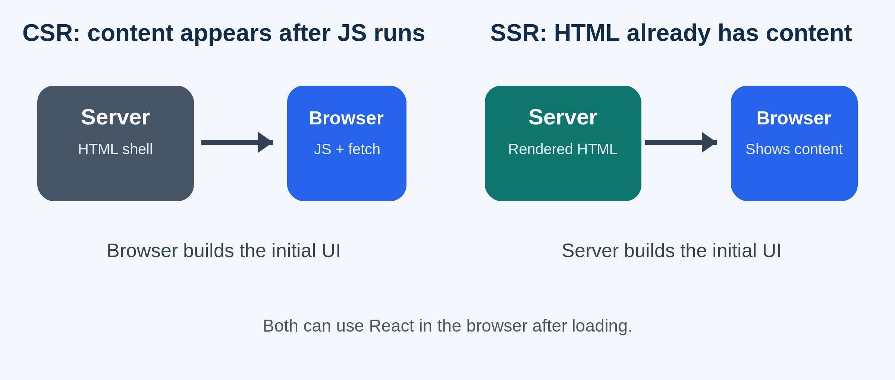
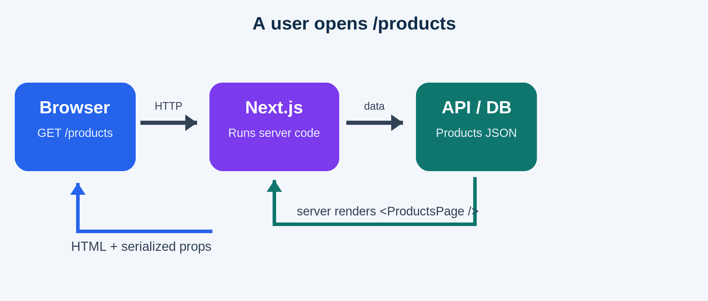
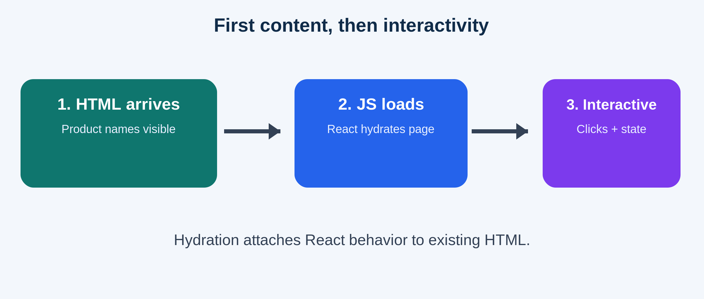
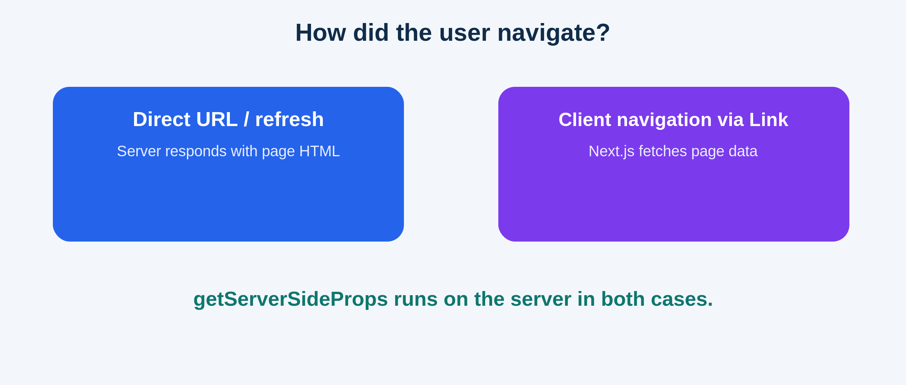

<!-- _class: lead -->
# Server-Side Rendering in Next.js
### The Pages Router and `getServerSideProps()`

**Essential question:** Who builds the HTML the browser first receives?

---
# Start with a familiar React problem

A customer visits **`/products`**.

- Our page needs product data from a database or API.
- In client-side rendering (CSR), the browser may receive a shell, run JavaScript, and then fetch data.
- **Could the server prepare the product list before sending the page?**



---
# SSR means the server prepares the HTML

- **SSR:** React renders the requested page to HTML on the server.
- The browser can display the product names from that HTML.
- Browser-side JavaScript then enables React interactions (*hydration*).

**SSR ≠ “no JavaScript in the browser.”**

---
# Follow one request: GET /products



**Next.js does the wiring:** read data → pass props → render HTML → respond.

---
# The server-side function

Create **`pages/products.jsx`** (Pages Router):

```jsx
export async function getServerSideProps() {
  const response = await fetch('https://dummyjson.com/products?limit=3');
  if (!response.ok) throw new Error('Products unavailable');

  const data = await response.json();
  return { props: { products: data.products } };
}
```

- Next.js calls this **on the server** when the page is requested.
- The returned `props` become inputs to the page component.

---
# The same file: a normal React page

```jsx
export default function ProductsPage({ products }) {
  return (
    <main>
      <h1>Products</h1>
      <ul>
        {products.map((p) => <li key={p.id}>{p.title}</li>)}
      </ul>
    </main>
  );
}
```

**Teaching point:** No `useEffect` is needed to fetch the initial list. The component receives ready-to-render data as props.

---
# What the browser actually gets

The initial response contains rendered markup, for example:

```html
<main>
  <h1>Products</h1>
  <ul><li>Essence Mascara Lash Princess</li>...</ul>
</main>
```

- Next.js also includes serialized page data needed for hydration.
- **Never put secrets in returned props:** clients can inspect them.

---
# Hydration: HTML first, interaction second



**SSR renders the initial view; hydration activates React in the browser.**

---
# Important twist: navigation changes the response



- Direct visit / refresh → rendered HTML response.
- Navigation using `next/link` → Next.js retrieves page data and renders the destination in the browser.
- **In both cases**, `getServerSideProps()` runs on the server.

---
# When is request-time SSR the right choice?

| Use `getServerSideProps()` when… | Consider another approach when… |
| --- | --- |
| Page needs request-specific data | Content rarely changes → static generation |
| Server must consult private credentials | Data only needed after a user action → client fetch |
| Initial HTML needs current server data | Server cost/latency outweighs the benefit |

**Scope:** `getServerSideProps()` is a **Pages Router** API. The modern **App Router** handles server rendering differently.

---
# Check your understanding

1. Where does `getServerSideProps()` execute?
2. What does `{ props: { products } }` do?
3. Why is hydration still needed?
4. Does clicking a Next.js `<Link>` skip the server function?

**One-sentence takeaway:** *The server fetches the initial data and builds the HTML; the browser displays it and hydrates React.*

<!-- Sources: https://nextjs.org/docs/pages/building-your-application/data-fetching/get-server-side-props ; https://nextjs.org/docs/pages/building-your-application/rendering/server-side-rendering -->
